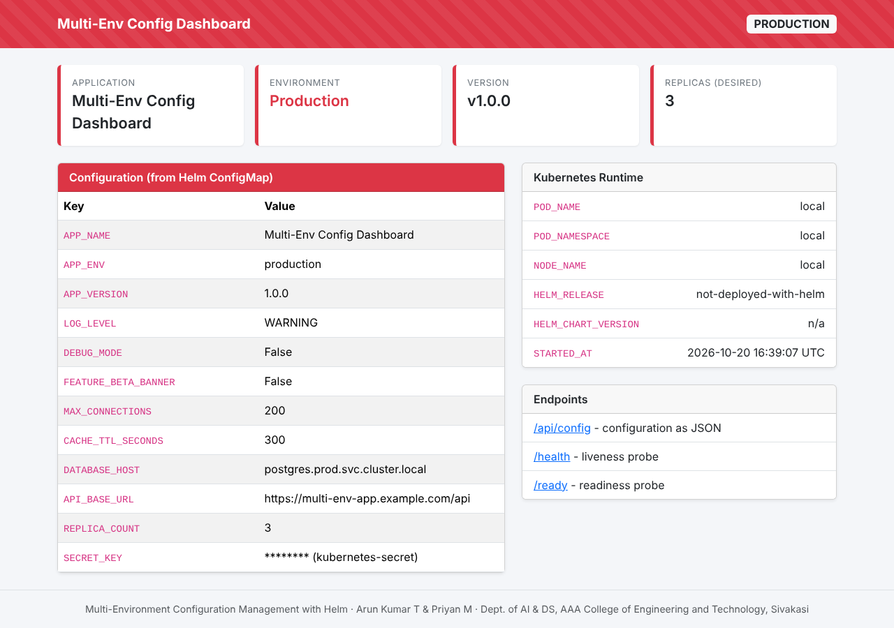
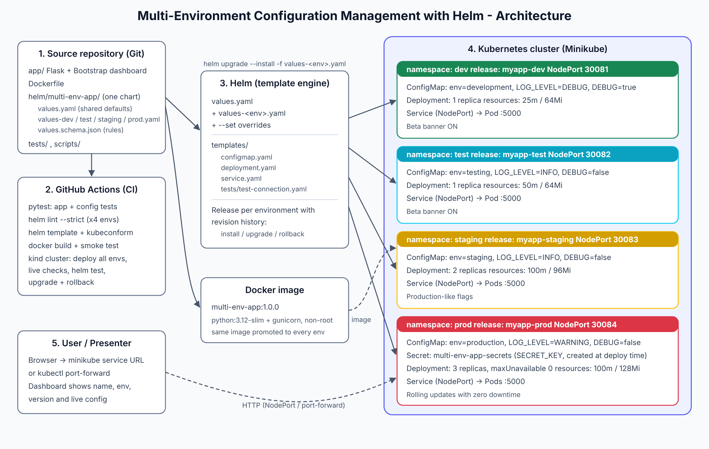
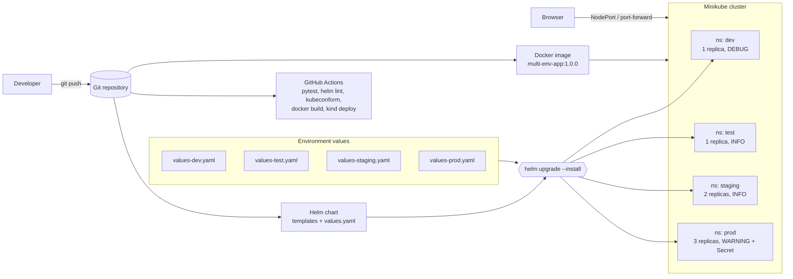

# Multi-Environment Configuration Management with Helm

A DevOps mini-project that deploys **one** containerised Flask application to **four** Kubernetes environments (Development, Testing, Staging, Production) using **one reusable Helm chart** and **one values file per environment**. Validation is automated with a JSON schema, `helm lint`, `kubeconform`, pytest and GitHub Actions.

| | |
|---|---|
| **Students** | Arun Kumar T (953724243007), Priyan M (953724243040) |
| **Department** | Artificial Intelligence and Data Science |
| **College** | AAA College of Engineering and Technology, Sivakasi |



---

## Contents

1. [Objectives](#1-objectives)
2. [Features](#2-features)
3. [Technology stack](#3-technology-stack)
4. [Architecture](#4-architecture)
5. [Workflow](#5-workflow)
6. [Project structure](#6-project-structure)
7. [Environment configuration matrix](#7-environment-configuration-matrix)
8. [Prerequisites](#8-prerequisites)
9. [Run locally (no Kubernetes)](#9-run-locally-no-kubernetes)
10. [Run with Docker](#10-run-with-docker)
11. [Deploy to Minikube with Helm](#11-deploy-to-minikube-with-helm)
12. [Helm command reference](#12-helm-command-reference)
13. [Testing and validation](#13-testing-and-validation)
14. [GitHub Actions CI](#14-github-actions-ci)
15. [Secrets handling](#15-secrets-handling)
16. [Presentation demo script](#16-presentation-demo-script)
17. [Troubleshooting](#17-troubleshooting)
18. [Verified results and what is untested](#18-verified-results-and-what-is-untested)
19. [Future enhancements](#19-future-enhancements)

---

## 1. Objectives

- Package an application **once** (one Docker image) and deploy it to any environment.
- Keep everything that differs between environments in small `values-<env>.yaml` files, not in templates or code.
- Catch configuration mistakes **before** deployment (schema validation, linting, rendering tests).
- Use the same, repeatable commands for install, upgrade and rollback in every environment.

## 2. Features

- **Flask + Bootstrap 5 dashboard** showing application name, environment, version, replica count, every configuration value and live Kubernetes runtime details (pod, namespace, node, Helm release).
- **Colour-coded environments**: green = development, blue = testing, yellow = staging, red (striped) = production.
- **JSON API** (`/api/config`) plus `/health` and `/ready` endpoints used by Kubernetes probes.
- **Reusable Helm chart** with ConfigMap, Deployment, Service, `NOTES.txt`, a `helm test` hook and a `values.schema.json` that rejects invalid values (unknown environment, 0 replicas, bad log level, secrets placed in the ConfigMap, invalid NodePort).
- **Automatic rollout on config change**: the Deployment carries a `checksum/config` annotation, so editing a values file restarts pods with the new config.
- **Production hardening**: 3 replicas, `maxUnavailable: 0` rolling updates, resource limits, non-root container, dropped Linux capabilities, `SECRET_KEY` loaded from a Kubernetes Secret.
- **Scripts** for Minikube setup, deployment, validation, upgrade/rollback demo, live environment tests and cleanup.
- **GitHub Actions** pipeline: pytest → helm lint/template/kubeconform → Docker smoke test → full deployment of all four environments to a kind cluster with live checks, `helm test`, upgrade and rollback.

## 3. Technology stack

| Layer | Technology |
|---|---|
| Application | Python 3.12, Flask 3.0, Gunicorn, Jinja2, HTML, CSS, Bootstrap 5.3 |
| Container | Docker (`python:3.12-slim`, non-root user) |
| Orchestration | Kubernetes on Minikube (local) / kind (CI) |
| Packaging and configuration | Helm 3 (chart + per-environment values + JSON schema) |
| Validation and testing | pytest, PyYAML, `helm lint`, `helm template`, kubeconform, `helm test`, Bash scripts |
| CI | GitHub Actions |

## 4. Architecture



(Editable source: [`docs/architecture.svg`](docs/architecture.svg). More detail: [`docs/architecture.md`](docs/architecture.md).)



Inside every namespace Helm creates the same three objects:

```
              values.yaml + values-<env>.yaml
                           |
                     helm template
                           v
 +------------------+   envFrom   +---------------------------+   selector   +-----------------+
 | ConfigMap        | ----------> | Deployment                | <----------- | Service         |
 | APP_ENV, LOG_... |             |  Pod(s): Flask/gunicorn   |              | NodePort 3008x  |
 +------------------+             |  probes: /health, /ready  |              +-----------------+
 (+ Secret in prod) ------------> |  checksum/config annot.   |                      ^
                                  +---------------------------+                      |
                                                                              Browser / curl
```

## 5. Workflow

1. **Develop** – change the Flask app or a values file and run `pytest` locally.
2. **Validate** – `./scripts/validate-helm.sh` lints the chart against `values.schema.json` for each environment, renders it and validates the generated Kubernetes objects with kubeconform. Mistakes such as `environment: qa` or `replicaCount: 0` fail here, before they reach a cluster.
3. **Continuous integration** – every push runs the same checks in GitHub Actions, builds the Docker image, then deploys all four environments to a temporary kind cluster and tests them.
4. **Build** – one image (`multi-env-app:1.0.0`) is built once and promoted unchanged through every environment.
5. **Deploy** – `helm upgrade --install myapp-<env> ./helm/multi-env-app -n <env> -f values-<env>.yaml`. Helm merges `values.yaml` with the environment file, renders the templates and creates a numbered **release revision**.
6. **Verify** – `helm test` and `./scripts/test-environments.sh` confirm that each running app reports the expected environment and settings.
7. **Upgrade / roll back** – `helm upgrade` creates a new revision. If something goes wrong, `helm rollback <release> <revision>` restores the previous configuration (with `--atomic`, failed upgrades roll back automatically).

## 6. Project structure

```
.
├── app/                              # Flask application
│   ├── app.py                        # routes: /, /health, /ready, /api/config
│   ├── config.py                     # reads configuration from environment variables
│   ├── requirements.txt
│   ├── templates/index.html          # Bootstrap dashboard
│   └── static/css/style.css
├── helm/multi-env-app/               # reusable Helm chart
│   ├── Chart.yaml
│   ├── values.yaml                   # shared defaults
│   ├── values-dev.yaml               # Development overrides
│   ├── values-test.yaml              # Testing overrides
│   ├── values-staging.yaml           # Staging overrides
│   ├── values-prod.yaml              # Production overrides
│   ├── values.schema.json            # validation rules for all values
│   ├── .helmignore
│   └── templates/
│       ├── _helpers.tpl              # names, labels, version helpers
│       ├── configmap.yaml
│       ├── deployment.yaml
│       ├── service.yaml
│       ├── NOTES.txt                 # post-install instructions
│       └── tests/test-connection.yaml  # `helm test` hook
├── scripts/
│   ├── common.sh                     # shared variables/functions
│   ├── minikube-setup.sh             # start Minikube, build image, create namespaces
│   ├── deploy.sh                     # deploy one env or all
│   ├── validate-helm.sh              # lint + template + kubeconform for every env
│   ├── test-environments.sh          # live checks against the running cluster
│   ├── upgrade-rollback-demo.sh      # upgrade -> history -> rollback
│   ├── docker-demo.sh                # all 4 environments in plain Docker (no Kubernetes)
│   └── cleanup.sh
├── tests/
│   ├── conftest.py
│   ├── test_app.py                   # Flask unit tests
│   └── test_helm_config.py           # per-environment values + rendered manifest tests
├── docs/
│   ├── architecture.md / .svg / .png
│   ├── project-report.md             # material for the academic report
│   ├── test-results.md               # actual test output
│   └── screenshots/                  # dashboard screenshots per environment
├── .github/workflows/helm-validation.yml
├── Dockerfile
├── .dockerignore
├── requirements-dev.txt
└── README.md
```

## 7. Environment configuration matrix

All values below come from `helm/multi-env-app/values-<env>.yaml` (anything not listed comes from `values.yaml`).

| Setting | Development | Testing | Staging | Production |
|---|---|---|---|---|
| Namespace / release | `dev` / `myapp-dev` | `test` / `myapp-test` | `staging` / `myapp-staging` | `prod` / `myapp-prod` |
| `APP_ENV` | development | testing | staging | production |
| Replicas | 1 | 1 | 2 | 3 |
| `LOG_LEVEL` | DEBUG | INFO | INFO | WARNING |
| `DEBUG_MODE` | true | false | false | false |
| `FEATURE_BETA_BANNER` | true | true | false | false |
| `MAX_CONNECTIONS` | 5 | 10 | 50 | 200 |
| `CACHE_TTL_SECONDS` | 10 | 30 | 120 | 300 |
| CPU request / limit | 25m / 100m | 50m / 150m | 100m / 250m | 100m / 500m |
| Memory request / limit | 64Mi / 128Mi | 64Mi / 128Mi | 96Mi / 192Mi | 128Mi / 256Mi |
| NodePort | 30081 | 30082 | 30083 | 30084 |
| `SECRET_KEY` source | auto-generated | auto-generated | auto-generated | Kubernetes Secret |
| Dashboard colour | green | blue | yellow | red |

## 8. Prerequisites

| Tool | Version used/tested | Install |
|---|---|---|
| Git | any | https://git-scm.com/downloads |
| Python | 3.10+ (tested 3.12, 3.13) | https://www.python.org/downloads/ |
| Docker Desktop / Docker Engine | 24+ | https://docs.docker.com/get-docker/ |
| Minikube | 1.33+ | https://minikube.sigs.k8s.io/docs/start/ |
| kubectl | 1.29+ | https://kubernetes.io/docs/tasks/tools/ |
| Helm | 3.14+ (tested 3.16.2) | https://helm.sh/docs/intro/install/ |

Windows (PowerShell as Administrator, with [Chocolatey](https://chocolatey.org/install)):

```powershell
choco install -y git python docker-desktop minikube kubernetes-cli kubernetes-helm
```

macOS (Homebrew): `brew install python minikube kubectl helm` and install Docker Desktop.

Ubuntu: install Docker Engine, then follow the Minikube, kubectl and Helm links above.

> **Windows users:** the `scripts/*.sh` files are Bash scripts. Run them from **Git Bash** or **WSL**, or type the equivalent commands shown in sections 11 and 12, which work in PowerShell.

Check the tools:

```bash
python --version && docker --version && minikube version && kubectl version --client && helm version
```

## 9. Run locally (no Kubernetes)

```bash
cd multi-env-helm-config          # the project folder
python -m venv .venv
source .venv/bin/activate         # Windows PowerShell: .venv\Scripts\Activate.ps1
pip install -r requirements-dev.txt

# run the tests
python -m pytest -v

# start the app as "staging"
cd app
APP_ENV=staging APP_VERSION=1.0.0 python app.py
#   PowerShell:  $env:APP_ENV="staging"; $env:APP_VERSION="1.0.0"; python app.py
```

Open http://localhost:5000 (dashboard) and http://localhost:5000/api/config (JSON).

## 10. Run with Docker

```bash
docker build -t multi-env-app:1.0.0 .
docker run --rm -p 5000:5000 -e APP_ENV=testing multi-env-app:1.0.0
```

Open http://localhost:5000. Any setting can be passed with `-e`, for example `-e LOG_LEVEL=DEBUG -e MAX_CONNECTIONS=25`.

To run **all four environments side by side** with the exact settings from the Helm values files (handy as a fallback demo when Minikube is not available):

```bash
pip install pyyaml                 # already installed if you used requirements-dev.txt
./scripts/docker-demo.sh up        # dev: http://localhost:8081, test: 8082, staging: 8083, prod: 8084
./scripts/docker-demo.sh down
```

## 11. Deploy to Minikube with Helm

### Option A – scripts (Linux, macOS, Git Bash, WSL)

```bash
chmod +x scripts/*.sh
./scripts/minikube-setup.sh        # start Minikube, build image inside it, create namespaces
./scripts/validate-helm.sh         # lint + render + schema-check every environment
./scripts/deploy.sh all            # install dev, test, staging, prod
./scripts/test-environments.sh     # live checks + helm test for every environment
./scripts/upgrade-rollback-demo.sh dev
```

### Option B – step-by-step commands (any shell, including PowerShell)

```bash
# 1. Start Minikube
minikube start --cpus=2 --memory=4096 --driver=docker

# 2. Build the image directly inside Minikube (no registry needed)
minikube image build -t multi-env-app:1.0.0 .
minikube image ls | grep multi-env-app          # PowerShell: minikube image ls | Select-String multi-env-app

# 3. Create one namespace per environment
kubectl create namespace dev
kubectl create namespace test
kubectl create namespace staging
kubectl create namespace prod

# 4. Production only: create the Secret (value is generated, never committed)
kubectl create secret generic multi-env-app-secrets -n prod --from-literal=SECRET_KEY="$(openssl rand -hex 32)"
#   PowerShell: kubectl create secret generic multi-env-app-secrets -n prod --from-literal=SECRET_KEY=$([guid]::NewGuid().ToString('N'))

# 5. Validate, then install each environment
helm lint ./helm/multi-env-app -f ./helm/multi-env-app/values-dev.yaml --strict
helm upgrade --install myapp-dev     ./helm/multi-env-app -n dev     -f ./helm/multi-env-app/values-dev.yaml     --wait
helm upgrade --install myapp-test    ./helm/multi-env-app -n test    -f ./helm/multi-env-app/values-test.yaml    --wait
helm upgrade --install myapp-staging ./helm/multi-env-app -n staging -f ./helm/multi-env-app/values-staging.yaml --wait
helm upgrade --install myapp-prod    ./helm/multi-env-app -n prod    -f ./helm/multi-env-app/values-prod.yaml    --wait

# 6. Check what is running
helm list -A
kubectl get pods,svc,configmap -n prod
```

### Open the dashboards

```bash
minikube service myapp-dev-multi-env-app     -n dev     --url
minikube service myapp-test-multi-env-app    -n test    --url
minikube service myapp-staging-multi-env-app -n staging --url
minikube service myapp-prod-multi-env-app    -n prod    --url
```

On Linux with the Docker driver the NodePorts are also reachable at `http://$(minikube ip):30081` … `30084`. With the Docker driver on **Windows/macOS**, `minikube service ... --url` opens a tunnel and prints a `127.0.0.1` URL; keep that terminal open while you use it. A port-forward always works:

```bash
kubectl port-forward -n prod svc/myapp-prod-multi-env-app 8080:80     # then open http://localhost:8080
```

## 12. Helm command reference

Replace `<env>` with `dev`, `test`, `staging` or `prod`.

| Purpose | Command |
|---|---|
| Lint with an environment's values (also checks the JSON schema) | `helm lint ./helm/multi-env-app -f ./helm/multi-env-app/values-<env>.yaml --strict` |
| Render manifests without a cluster | `helm template myapp-<env> ./helm/multi-env-app -f ./helm/multi-env-app/values-<env>.yaml` |
| Server-side dry run | `helm upgrade --install myapp-<env> ./helm/multi-env-app -n <env> -f ./helm/multi-env-app/values-<env>.yaml --dry-run=server` |
| Install / upgrade | `helm upgrade --install myapp-<env> ./helm/multi-env-app -n <env> -f ./helm/multi-env-app/values-<env>.yaml --atomic --wait` |
| Change one value | `helm upgrade myapp-dev ./helm/multi-env-app -n dev -f ./helm/multi-env-app/values-dev.yaml --set config.LOG_LEVEL=INFO` |
| Upgrade the displayed version | `helm upgrade myapp-dev ./helm/multi-env-app -n dev -f ./helm/multi-env-app/values-dev.yaml --set app.version=1.1.0` |
| Deploy a new image tag | `minikube image build -t multi-env-app:1.1.0 .` then `helm upgrade ... --set image.tag=1.1.0` |
| Release history | `helm history myapp-<env> -n <env>` |
| Roll back to revision N | `helm rollback myapp-<env> <N> -n <env> --wait` |
| Values in use | `helm get values myapp-<env> -n <env> --all` |
| Generated manifests in use | `helm get manifest myapp-<env> -n <env>` |
| Run the chart's test hook | `helm test myapp-<env> -n <env>` |
| List releases | `helm list -A` |
| Uninstall | `helm uninstall myapp-<env> -n <env>` (or `./scripts/cleanup.sh` for everything) |

Try a value the schema rejects to see validation in action:

```bash
helm lint ./helm/multi-env-app --set environment=qa          # fails: not an allowed environment
helm lint ./helm/multi-env-app --set replicaCount=0          # fails: minimum is 1
helm lint ./helm/multi-env-app --set config.SECRET_KEY=abc   # fails: secrets are not allowed in the ConfigMap
```

## 13. Testing and validation

| Layer | Command | What it checks |
|---|---|---|
| Unit tests | `python -m pytest tests/test_app.py -v` | dashboard shows name/env/version for all 4 environments, `/health`, `/ready`, `/api/config`, secret never exposed, invalid env fallback, colour themes, beta banner toggle |
| Configuration tests | `python -m pytest tests/test_helm_config.py -v` | required chart files exist; each values file sets the right environment; replica minimums (prod ≥ 3, staging ≥ 2); same config keys in every env; unique NodePorts; prod hardening (no debug, WARNING logs, Secret, `maxUnavailable: 0`); no hard-coded secrets; **with Helm installed:** `helm lint --strict`, rendered ConfigMap/Deployment/Service match each env, config change changes the checksum, the schema rejects 5 kinds of bad input |
| Chart validation | `./scripts/validate-helm.sh` | `helm lint --strict`, `helm template`, rendered `APP_ENV`, kubeconform schema validation (if installed) for every env; writes manifests to `dist/rendered/` |
| Live cluster | `./scripts/test-environments.sh [env\|all]` | release deployed, all replicas ready, running app reports the right `APP_ENV`, `REPLICA_COUNT` matches the Deployment, `/health` OK, prod debug off, prod `SECRET_KEY` from Secret, `helm test` passes |
| Helm test hook | `helm test myapp-<env> -n <env>` | a busybox pod calls the Service and checks `/health` and the reported environment |

## 14. GitHub Actions CI

Workflow: [`.github/workflows/helm-validation.yml`](.github/workflows/helm-validation.yml). It runs on every push, on pull requests and manually (`workflow_dispatch`).

| Job | Steps |
|---|---|
| `python-tests` | Python 3.12 + Helm 3.16.2 → `pip install -r requirements-dev.txt` → `pytest -v` |
| `helm-validate` | Helm + kubeconform → `./scripts/validate-helm.sh` → upload rendered manifests as an artifact |
| `docker-build` | `docker build` → run the container → check `/health`, `/api/config` and the dashboard |
| `deploy-kind` | (after the 3 jobs above pass) create a kind cluster → load the image → `./scripts/deploy.sh all` → `./scripts/test-environments.sh all` → `./scripts/upgrade-rollback-demo.sh dev` |

To use it in your own repository, push the project to GitHub and open the **Actions** tab.

## 15. Secrets handling

- No password, token or key is stored in the repository. `tests/test_helm_config.py::test_no_hardcoded_secrets` and the schema rule on `config` enforce this.
- Non-sensitive settings go in the ConfigMap via `values-<env>.yaml`.
- Sensitive settings go in a Kubernetes Secret created at deploy time (`kubectl create secret …` or `scripts/deploy.sh`, which generates a random value). The chart only references it by name (`existingSecret`).
- If no secret is supplied (dev/test/staging), the app generates a random `SECRET_KEY` at start-up.
- The dashboard and API only show `******** (kubernetes-secret)` or `******** (auto-generated)`.

## 16. Presentation demo script

About 10 minutes, after running `./scripts/minikube-setup.sh` beforehand.

1. **Show the chart:** open `values.yaml` and `values-prod.yaml` side by side and explain "same templates, different values".
2. **Validate:** `./scripts/validate-helm.sh`, then show a failure with `helm lint ./helm/multi-env-app --set environment=qa`.
3. **Deploy all environments:** `./scripts/deploy.sh all`, then `helm list -A` and `kubectl get pods -A -l app.kubernetes.io/name=multi-env-app`.
4. **Compare dashboards:** open the dev and prod URLs next to each other (green vs. red, 1 vs. 3 replicas, DEBUG vs. WARNING, beta banner on/off).
5. **Show the rendered difference:** `helm get values myapp-prod -n prod --all`.
6. **Upgrade:** `helm upgrade myapp-dev ./helm/multi-env-app -n dev -f ./helm/multi-env-app/values-dev.yaml --set app.version=1.1.0` and refresh: the version changes to v1.1.0 and the pod restarts automatically (checksum annotation).
7. **History and rollback:** `helm history myapp-dev -n dev`, then `helm rollback myapp-dev 1 -n dev` and refresh: back to v1.0.0.
8. **Test:** `./scripts/test-environments.sh all` (all PASS) and open the GitHub Actions tab to show the green pipeline.

## 17. Troubleshooting

| Problem | Fix |
|---|---|
| `ErrImagePull` / `ImagePullBackOff` for `multi-env-app` | The image is not inside Minikube. Run `minikube image build -t multi-env-app:1.0.0 .` (do not use `imagePullPolicy: Always`). |
| prod pods stuck in `CreateContainerConfigError` | The Secret is missing. Create `multi-env-app-secrets` in namespace `prod` (section 11, step 4) or use `./scripts/deploy.sh prod`. |
| `provided port is already allocated` | Another Service uses the NodePort. Change `service.nodePort` in that environment's values file. |
| `minikube service` URL does not open on Windows/macOS | Keep the terminal running `minikube service ... --url` open, or use `kubectl port-forward`. |
| `helm lint` fails with `values don't meet the specifications of the schema` | A value breaks a rule in `values.schema.json`; the error message names the field. |
| Dashboard has no styling | Bootstrap is loaded from the jsDelivr CDN; the browser needs internet access. `style.css` still applies offline. |
| `helm test` pod fails with an image pull error | The test uses `busybox:1.36` from Docker Hub. Pull it once (`minikube image pull busybox:1.36`) or set `--set tests.image=<another image with wget>`. |
| `bash\r: No such file or directory` on Windows | Git converted line endings. Run `git config --global core.autocrlf input` and clone again, or run `dos2unix scripts/*.sh`. |

## 18. Verified results and what is untested

The full output is in [`docs/test-results.md`](docs/test-results.md). In summary:

| Check | Where it ran | Result |
|---|---|---|
| pytest (62 tests, including the Helm rendering tests) | development sandbox (Python 3.13, Helm 3.16) and GitHub Actions (Python 3.12) | 62 passed |
| `validate-helm.sh` (lint --strict, template, kubeconform for K8s 1.31) | sandbox and GitHub Actions | 4/4 environments valid, 4/4 resources valid each |
| Schema rejects invalid values | sandbox and GitHub Actions | 5/5 rejected |
| Docker build, non-root user, HEALTHCHECK, endpoints | sandbox and GitHub Actions | passed (`healthy`, uid 10001) |
| `scripts/docker-demo.sh up` (4 environments in Docker) | sandbox | all 4 containers `healthy`, each reports its own environment |
| Deploy all 4 environments to a real Kubernetes cluster (kind, K8s v1.31) | GitHub Actions | all releases `deployed`, pods `Running` (1/1/2/3 replicas) |
| Live environment checks + `helm test` | GitHub Actions on kind | 26 passed, 0 failed |
| Upgrade 1.0.0 → 1.1.0, then rollback to revision 1 | GitHub Actions on kind | version 1.1.0 after upgrade, 1.0.0 after rollback |

**Not tested:**

- **Minikube itself.** The chart was deployed to kind (also a real Kubernetes cluster), not Minikube. The sandbox used to build this project cannot run nested containers. The Minikube-specific commands (`minikube start`, `minikube image build`, `minikube service`) and `scripts/minikube-setup.sh` were not executed.
- **Windows and macOS.** All commands ran on Linux. The PowerShell variants in this README were not executed.
- **Dashboard screenshots** in `docs/screenshots/` were taken from Docker containers started with each environment's values (not from pods), so the runtime panel shows `local` instead of pod names.

## 19. Future enhancements

- Push images to a registry (Docker Hub/GHCR) from CI and deploy by image digest.
- GitOps with Argo CD or Flux, one Application per environment.
- External secret management (Sealed Secrets, External Secrets Operator, HashiCorp Vault).
- Ingress with per-environment hostnames and TLS.
- HorizontalPodAutoscaler and PodDisruptionBudget for production.
- Prometheus metrics endpoint and Grafana dashboards.
- `helm-diff` in pull requests to preview configuration changes.
