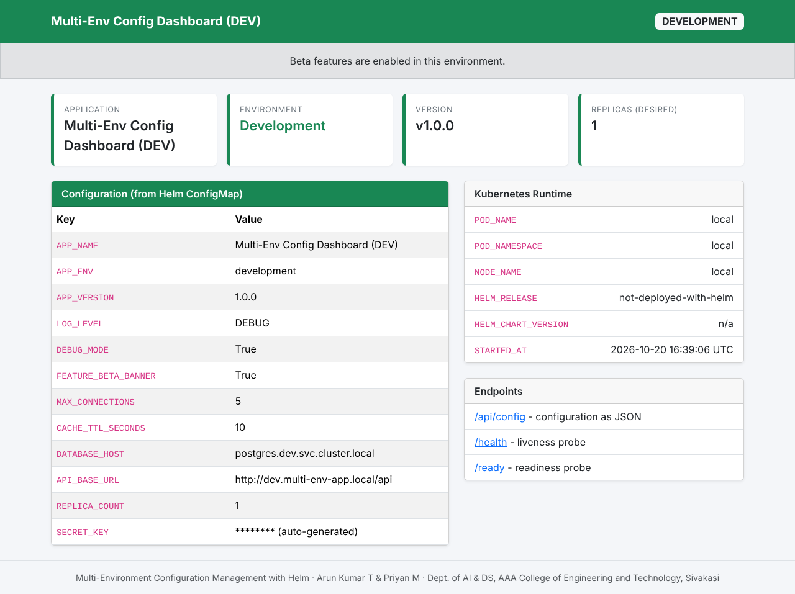
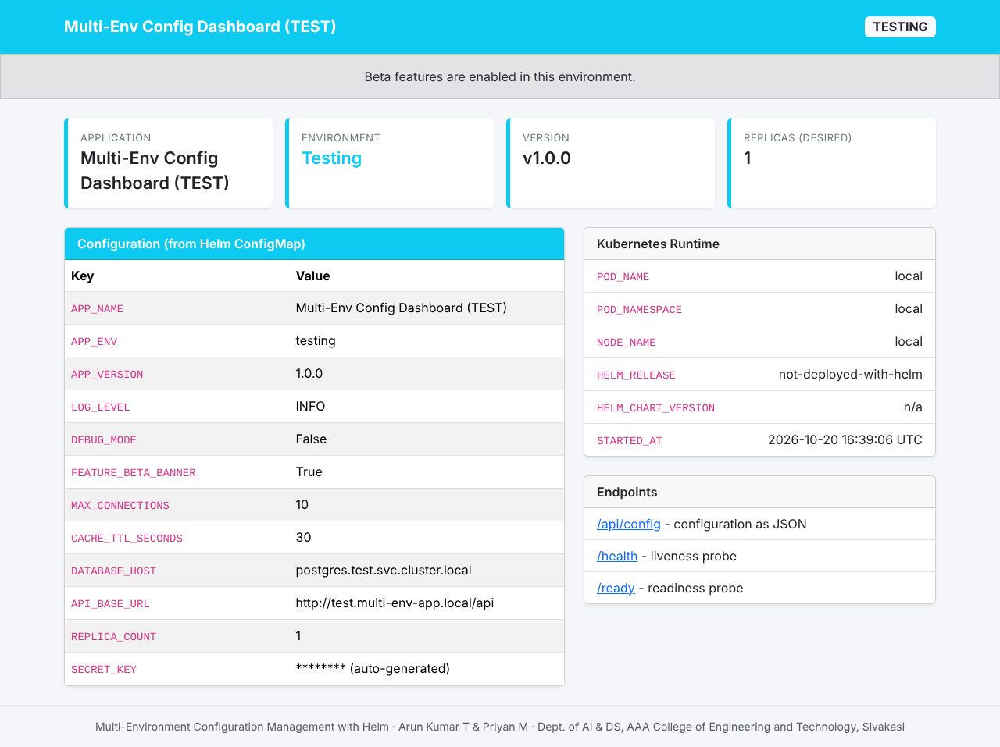
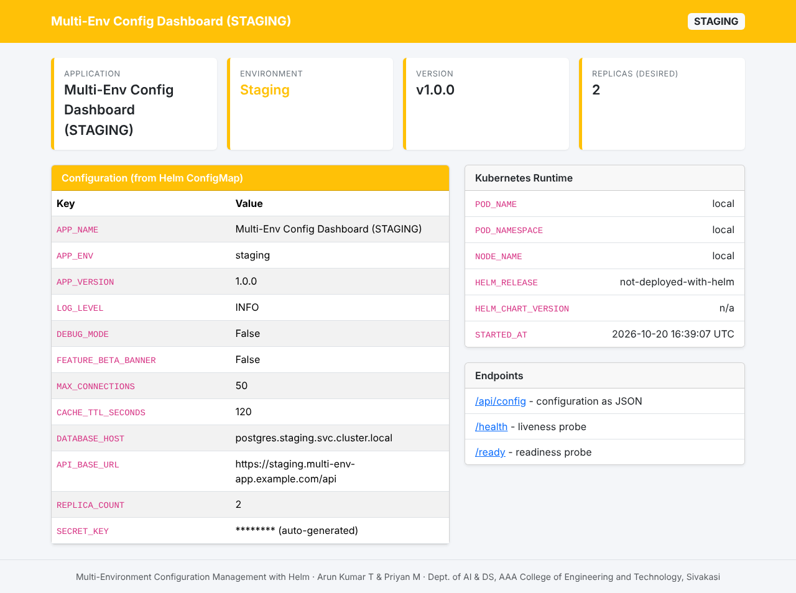

# Project Report Material

**Title:** Multi-Environment Configuration Management with Helm
**Team:** Arun Kumar T (953724243007), Priyan M (953724243040)
**Department:** Artificial Intelligence and Data Science
**College:** AAA College of Engineering and Technology, Sivakasi

This file collects material you can adapt for each chapter of the report. The numbers and outputs are taken from the actual test runs in [`test-results.md`](test-results.md).

---

## Abstract

Modern applications pass through several environments (development, testing, staging and production) before reaching users. Each environment needs different settings such as replica count, log level, resource limits and feature flags. Keeping a separate set of Kubernetes manifests for each environment duplicates effort and leads to configuration drift and deployment errors. This project uses Helm, the package manager for Kubernetes, to deploy a Python Flask web application to four environments from one reusable chart. Only the differences between environments are kept in small YAML values files, and a JSON schema, automated tests and a GitHub Actions pipeline validate every change before deployment. The application shows its own environment, version and configuration on a Bootstrap dashboard, which makes the effect of each configuration visible. In testing, the chart passed strict linting and Kubernetes schema validation for all four environments, 62 automated tests passed, and a full deployment to a Kubernetes cluster passed 26 of 26 live checks, including an upgrade and a rollback.

## 1. Introduction

Kubernetes describes applications with YAML manifests. When the same application must run in several environments, teams often copy the manifests and edit them by hand, which causes inconsistencies ("it works in staging but not in production"). Helm solves this by turning manifests into templates and supplying environment-specific values at install time. Helm also records every deployment as a numbered revision, which makes upgrades and rollbacks a single command.

## 2. Problem statement

- Duplicated manifests per environment are hard to keep consistent.
- Configuration errors (wrong environment name, debug mode in production, hard-coded passwords) are often found only after deployment.
- Manual deployments are not repeatable, and rolling back a bad change is slow.

## 3. Objectives

1. Build a simple web application that displays its environment-specific configuration.
2. Containerise it with Docker so the same image runs everywhere.
3. Write one reusable Helm chart with separate values files for Development, Testing, Staging and Production.
4. Validate configurations automatically (schema, lint, rendering tests, CI).
5. Demonstrate install, upgrade and rollback on a local Kubernetes cluster (Minikube).

## 4. Existing system vs. proposed system

| Aspect | Existing (manual YAML per environment) | Proposed (Helm chart + values files) |
|---|---|---|
| Manifests | 4 copies of every file | 1 set of templates |
| Environment differences | Scattered across copies | Collected in `values-<env>.yaml` |
| Validation | Manual review | JSON schema, pytest, `helm lint`, kubeconform, CI |
| Deployment | Many `kubectl apply` commands | One `helm upgrade --install` |
| Rollback | Re-apply old files by hand | `helm rollback <release> <revision>` |
| Secrets | Often committed in YAML | Kubernetes Secret created at deploy time |

## 5. System requirements

**Hardware (minimum for Minikube):** 2 CPU cores, 8 GB RAM (4 GB given to Minikube), 20 GB free disk space.

**Software:** Windows 10/11, macOS or Linux; Docker Desktop/Engine; Minikube; kubectl; Helm 3; Python 3.10+; Git; a web browser.

## 6. System design

See [`architecture.md`](architecture.md) and the diagram [`architecture.png`](architecture.png).

### Modules

1. **Web application module:** Flask routes (`/`, `/api/config`, `/health`, `/ready`), configuration loader, Bootstrap dashboard.
2. **Containerisation module:** Dockerfile, non-root runtime, health check.
3. **Helm chart module:** templates (ConfigMap, Deployment, Service, test pod), helpers, default values, schema.
4. **Environment configuration module:** four values files.
5. **Deployment automation module:** shell scripts for setup, deployment, upgrade/rollback and cleanup.
6. **Validation and testing module:** pytest suites, validation script, live environment tests, `helm test`.
7. **CI module:** GitHub Actions workflow.

## 7. Implementation highlights

- **Configuration as environment variables:** the app never reads files or contains environment-specific code; everything comes from the ConfigMap, following the Twelve-Factor App principle.
- **Schema validation:** `values.schema.json` restricts `environment` to four names, `replicaCount` to 1–10, `LOG_LEVEL` to standard levels and forbids secret keys inside `config`.
- **Automatic rollout on configuration change:** a SHA-256 checksum of the ConfigMap is stored as a pod annotation.
- **Production safeguards:** 3 replicas, zero-downtime rolling updates, resource limits, `SECRET_KEY` from a Kubernetes Secret, debug disabled (enforced by tests).
- **Visual feedback:** each environment has its own colour on the dashboard, so the audience can see which environment is shown.

## 8. Testing

| Test type | Tool | Count / scope | Result |
|---|---|---|---|
| Unit tests (Flask) | pytest | 15 tests | Passed |
| Configuration and policy tests | pytest + PyYAML | 32 tests | Passed |
| Rendering and schema tests | pytest + Helm | 15 tests | Passed |
| Chart lint and Kubernetes schema | `helm lint --strict`, kubeconform | 4 environments × 4 resources | Valid |
| Container smoke test | Docker | health, API, dashboard, non-root user | Passed |
| Live deployment tests | `test-environments.sh`, `helm test` on kind (K8s 1.31) | 26 checks | 26 passed, 0 failed |
| Upgrade and rollback | `upgrade-rollback-demo.sh` | 1.0.0 → 1.1.0 → 1.0.0 | Passed |

Full output: [`test-results.md`](test-results.md).

**Limitations of testing:** the Kubernetes tests ran on kind in GitHub Actions, not on Minikube, and all tests ran on Linux. Minikube and Windows steps still need to be run on your own computer before the presentation.

## 9. Results

Screenshots of the dashboard for each environment are in [`screenshots/`](screenshots/):

| Development | Testing |
|---|---|
|  |  |
| **Staging** | **Production** |
|  |  |

A silent 2-minute demo video is in [`demo-video.mp4`](demo-video.mp4).

These were taken from Docker containers started with each environment's settings. For the report, consider replacing them with screenshots taken from your own Minikube deployment (the runtime panel will then show real pod names), plus screenshots of `helm list -A`, `helm history`, `kubectl get pods -A` and the green GitHub Actions run.

## 10. Conclusion

The project shows that one Helm chart with small per-environment values files can replace duplicated manifests, keep environments consistent and make deployments repeatable. Automated validation catches configuration mistakes before they reach a cluster, and Helm's release history makes upgrades and rollbacks safe and fast.

## 11. Future scope

GitOps with Argo CD, external secret managers (Vault, Sealed Secrets), Ingress with TLS, autoscaling, monitoring with Prometheus and Grafana, image publishing to a container registry and `helm diff` previews in pull requests.

## 12. References

1. Helm Documentation – https://helm.sh/docs/
2. Helm Chart Best Practices – https://helm.sh/docs/chart_best_practices/
3. Kubernetes Documentation – https://kubernetes.io/docs/
4. Minikube Documentation – https://minikube.sigs.k8s.io/docs/
5. Flask Documentation – https://flask.palletsprojects.com/
6. Bootstrap 5 Documentation – https://getbootstrap.com/docs/5.3/
7. GitHub Actions Documentation – https://docs.github.com/actions
8. kubeconform – https://github.com/yannh/kubeconform
9. The Twelve-Factor App, "III. Config" – https://12factor.net/config
